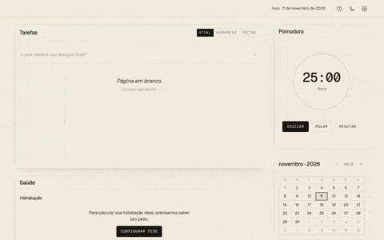
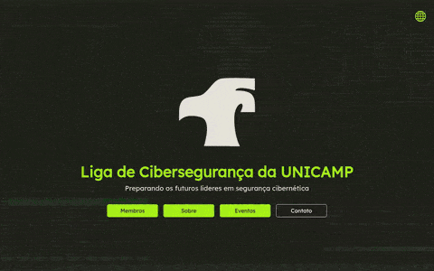
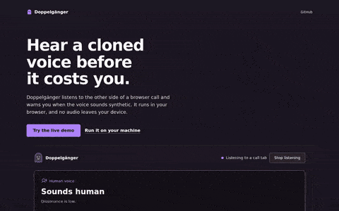
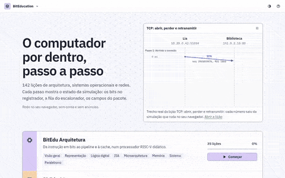
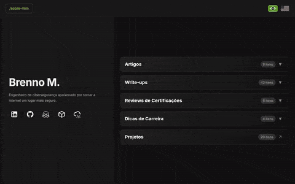
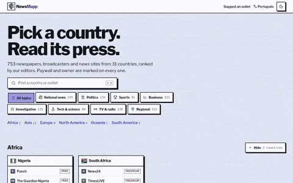

  

## Featured

<table>
  <tr>
    <td width="25%" valign="top">  <b>pwncortex</b> <small>Self-hosted AI-powered pentest orchestration platform.</small>  </td>
    <td width="25%" valign="top">  <b>no-distraction</b> <small>Calendar, tasks, notes and pomodoro on one screen.</small>  </td>
    <td width="25%" valign="top">  <b>aporte</b> <small>Self-hosted portfolio rebalancing and backtesting.</small>  </td>
    <td width="25%" valign="top">  <b>lics-unicamp/website</b> <small>Website of the UNICAMP cybersecurity league.</small>  </td>
  </tr>
  <tr>
    <td width="25%" valign="top">  <b>escalint</b> <small>Static analyzer for AWS IAM privilege escalation paths.</small>  </td>
    <td width="25%" valign="top">  <b>blindsight</b> <small>Offline verifier for Safe multisig transactions.</small>  </td>
    <td width="25%" valign="top">  <b>oraclint</b> <small>Static security linter for Chainlink node deployments.</small>  </td>
    <td width="25%" valign="top">  <b>oraclewatch</b> <small>Read-only monitor for Chainlink Data Feeds.</small>  </td>
  </tr>
  <tr>
    <td width="25%" valign="top">  <b>doppelganger</b> <small>In-browser detector for cloned voices on live calls.</small>  </td>
    <td width="25%" valign="top">  <b>BitEducation</b> <small>Interactive lessons on networks, OS and architecture.</small>  </td>
    <td width="25%" valign="top">  <b>brennocm.github.io</b> <small>Articles, write-ups and certification reviews.</small>  </td>
    <td width="25%" valign="top">  <b>NewsMapp</b> <small>The world's news outlets, by country and topic.</small>  </td>
  </tr>
</table>

## Projects

<table>
  <tr>
    <td width="50%" valign="top">
<code>ai pentest</code> <a href="https://github.com/brennocm/pwncortex"><b>pwncortex</b></a> <small>Self-hosted pentest platform with an AI chat that knows the whole engagement.</small>
  
<code>cloudsec</code> <a href="https://github.com/brennocm/oci-secops"><b>oci-secops</b></a> <small>Provisions and hardens Oracle Cloud Always Free instances for security labs.</small>  <a href="https://github.com/brennocm/escalint"><b>escalint</b></a> <small>Finds every path from an IAM principal to admin in a read-only snapshot.</small>
  
<code>productivity</code> <a href="https://github.com/no-distraction/no-distraction.github.io"><b>no-distraction</b></a> <small>Calendar, tasks, notes and pomodoro on one screen. Offline, no account.</small>
  
<code>finance</code> <a href="https://github.com/brennocm/aporte"><b>aporte</b></a> <small>Portfolio backtesting with monthly contributions and rebalancing.</small>
  
<code>ai security</code> <a href="https://github.com/brennocm/doppelganger"><b>doppelganger</b></a> <small>Detects cloned voices in live calls, in the browser.</small>
  
<code>recon</code> <a href="https://github.com/brennocm/fast-enum"><b>fast-enum</b></a> <small>Subdomain enumeration and crawling for pentests and bug bounty.</small>  <a href="https://github.com/brennocm/basic-enum-tools"><b>basic-enum-tools</b></a> <small>Installs and configures common recon tools.</small>
  
<code>appsec</code> <a href="https://github.com/brennocm/assistant-cap"><b>assistant-cap</b></a> <small>Study material for the Certified AppSec Practitioner exam.</small>
  
<code>blog</code> <a href="https://github.com/brennocm/brennocm.github.io"><b>brennocm.github.io</b></a> <small>Personal blog with technical articles on information security.</small>
    </td>
    <td width="50%" valign="top">
<code>privacy</code> <a href="https://github.com/brennocm/wg-auto"><b>wg-auto</b></a> <small>Installs and configures WireGuard on servers and clients.</small>  <a href="https://github.com/brennocm/bridge-tor-setup"><b>bridge-tor-setup</b></a> <small>Hardens a Debian VPS and deploys a Tor obfs4 bridge with monitoring.</small>  <a href="https://github.com/brennocm/tiktok-unwall"><b>tiktok-unwall</b></a> <small>Browser extension that removes TikTok's login wall.</small>  <a href="https://github.com/brennocm/keyguardian"><b>keyguardian</b></a> <small>Password vault in Flutter, encrypted with a master key.</small>
  
<code>community</code> <a href="https://github.com/lics-unicamp/website"><b>lics-unicamp/website</b></a> <small>Website of the UNICAMP cybersecurity league.</small>  <a href="https://github.com/lics-unicamp/scoring_system"><b>lics-unicamp/scoring_system</b></a> <small>Internal scoring system for league members.</small>
  
<code>web3-sec</code> <a href="https://github.com/brennocm/blindsight"><b>blindsight</b></a> <small>Offline verifier for Safe transactions. Flags takeovers like the Bybit one.</small>  <a href="https://github.com/brennocm/oraclint"><b>oraclint</b></a> <small>Security linter for Chainlink node deployments.</small>  <a href="https://github.com/brennocm/oraclewatch"><b>oraclewatch</b></a> <small>Read-only monitor for Chainlink Data Feeds on Ethereum and L2s.</small>
  
<code>awareness</code> <a href="https://github.com/FastPhish/prototype"><b>FastPhish</b></a> <small>Phishing simulation SaaS on GoPhish and Terraform, one server per campaign.</small>
  
<code>education</code> <a href="https://github.com/BitEducation/biteducation.github.io"><b>BitEducation</b></a> <small>Interactive lessons on networks, operating systems and computer architecture.</small>
  
<code>news</code> <a href="https://github.com/newsmapp/newsmapp.github.io"><b>NewsMapp</b></a> <small>Directory of news outlets in 31 countries, with paywall and owner marked on each one.</small>
    </td>
  </tr>
</table>
