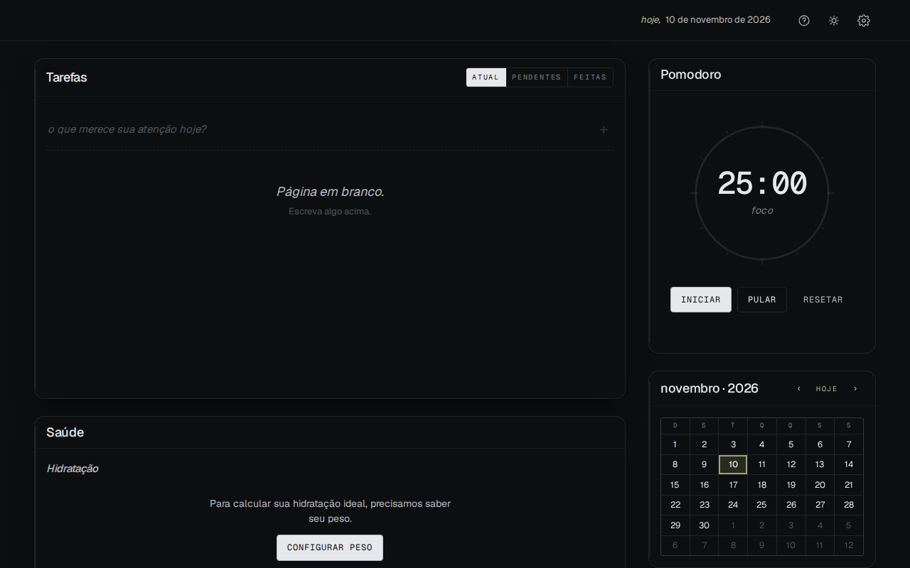
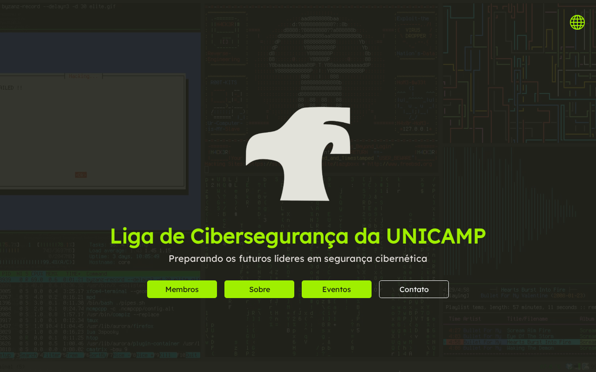
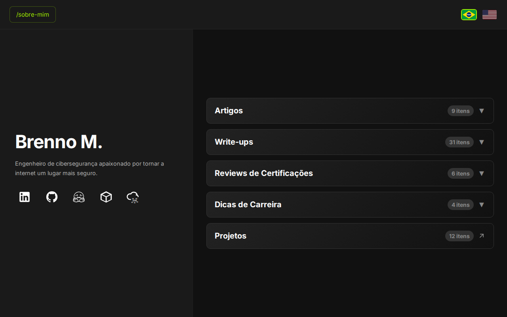

  

## Featured

<table>
  <tr>
    <td width="25%" valign="top">  <b>pwncortex</b> Self-hosted AI-powered pentest orchestration platform.  </td>
    <td width="25%" valign="top">  <b>no-distraction</b> Calendar, tasks, notes and pomodoro on one screen.  </td>
    <td width="25%" valign="top">  <b>aporte</b> Self-hosted portfolio rebalancing and backtesting.  </td>
    <td width="25%" valign="top">  <b>lics-unicamp/website</b> Website of the UNICAMP cybersecurity league.  </td>
  </tr>
  <tr>
    <td width="25%" valign="top">  <b>escalint</b> Static analyzer for AWS IAM privilege escalation paths.  </td>
    <td width="25%" valign="top">  <b>blindsight</b> Offline verifier for Safe multisig transactions.  </td>
    <td width="25%" valign="top">  <b>oraclint</b> Static security linter for Chainlink node deployments.  </td>
    <td width="25%" valign="top">  <b>oraclewatch</b> Read-only monitor for Chainlink Data Feeds.  </td>
  </tr>
  <tr>
    <td width="25%" valign="top">  <b>doppelganger</b> In-browser detector for cloned voices on live calls.  </td>
    <td width="25%" valign="top">  <b>BitEducation</b> Interactive lessons on networks, OS and architecture.  </td>
    <td width="25%" valign="top">  <b>brennocm.github.io</b> Articles, write-ups and certification reviews.  </td>
    <td width="25%"></td>
  </tr>
</table>

## Projects

<table>
  <tr>
    <td width="50%" valign="top">
<code>ai pentest</code> <a href="https://github.com/brennocm/pwncortex"><b>pwncortex</b></a> Self-hosted pentest platform with an AI chat that knows the whole engagement.
  
<code>cloud</code> <a href="https://github.com/brennocm/oci-secops"><b>oci-secops</b></a> Provisions and hardens Oracle Cloud Always Free instances for security labs.  <a href="https://github.com/brennocm/escalint"><b>escalint</b></a> Finds every path from an IAM principal to admin in a read-only snapshot.
  
<code>productivity</code> <a href="https://github.com/no-distraction/no-distraction.github.io"><b>no-distraction</b></a> Calendar, tasks, notes and pomodoro on one screen. Offline, no account.
  
<code>finance</code> <a href="https://github.com/brennocm/aporte"><b>aporte</b></a> Portfolio backtesting with monthly contributions and rebalancing.
  
<code>deepfake</code> <a href="https://github.com/brennocm/doppelganger"><b>doppelganger</b></a> Detects cloned voices in live calls, in the browser.
  
<code>recon</code> <a href="https://github.com/brennocm/fast-enum"><b>fast-enum</b></a> Subdomain enumeration and crawling for pentests and bug bounty.  <a href="https://github.com/brennocm/basic-enum-tools"><b>basic-enum-tools</b></a> Installs and configures common recon tools.
  
<code>appsec</code> <a href="https://github.com/brennocm/assistant-cap"><b>assistant-cap</b></a> Study material for the Certified AppSec Practitioner exam.
  
<code>blog</code> <a href="https://github.com/brennocm/brennocm.github.io"><b>brennocm.github.io</b></a> Personal blog with technical articles on information security.
    </td>
    <td width="50%" valign="top">
<code>privacy</code> <a href="https://github.com/brennocm/wg-auto"><b>wg-auto</b></a> Installs and configures WireGuard on servers and clients.  <a href="https://github.com/brennocm/bridge-tor-setup"><b>bridge-tor-setup</b></a> Hardens a Debian VPS and deploys a Tor obfs4 bridge with monitoring.  <a href="https://github.com/brennocm/tiktok-unwall"><b>tiktok-unwall</b></a> Browser extension that removes TikTok's login wall.  <a href="https://github.com/brennocm/keyguardian"><b>keyguardian</b></a> Password vault in Flutter, encrypted with a master key.
  
<code>community</code> <a href="https://github.com/lics-unicamp/website"><b>lics-unicamp/website</b></a> Website of the UNICAMP cybersecurity league.  <a href="https://github.com/lics-unicamp/scoring_system"><b>lics-unicamp/scoring_system</b></a> Internal scoring system for league members.
  
<code>web3-sec</code> <a href="https://github.com/brennocm/blindsight"><b>blindsight</b></a> Offline verifier for Safe transactions. Flags takeovers like the Bybit one.  <a href="https://github.com/brennocm/oraclint"><b>oraclint</b></a> Security linter for Chainlink node deployments.  <a href="https://github.com/brennocm/oraclewatch"><b>oraclewatch</b></a> Read-only monitor for Chainlink Data Feeds on Ethereum and L2s.
  
<code>phishing</code> <a href="https://github.com/FastPhish/prototype"><b>FastPhish</b></a> Phishing simulation SaaS on GoPhish and Terraform, one server per campaign.
  
<code>education</code> <a href="https://github.com/BitEducation/biteducation.github.io"><b>BitEducation</b></a> Interactive lessons on networks, operating systems and computer architecture.
    </td>
  </tr>
</table>
